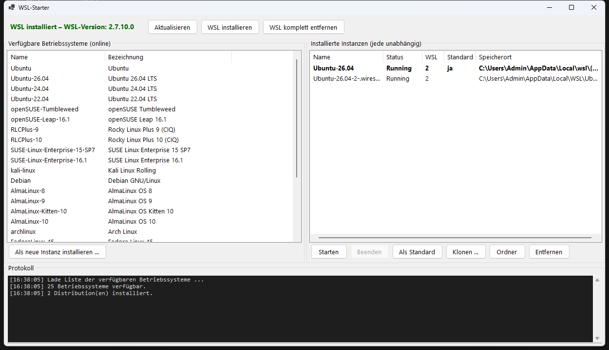

# WSL-Starter

Windows-Programm zum Verwalten des **Windows-Subsystems für Linux (WSL)**: verfügbare Linux-Distributionen anzeigen, als **beliebig viele voneinander unabhängige Instanzen** installieren, klonen, starten, beenden und wieder entfernen.



## Funktionen

- **Verfügbare Betriebssysteme** aus `wsl --list --online` anzeigen (Ubuntu, Debian, openSUSE, Fedora, AlmaLinux, Kali …).
- **Als neue Instanz installieren:** dieselbe Distribution mehrfach unter eigenem Namen und an frei wählbarem Speicherort (z. B. `D:\WSL\Ubuntu-Test`).
- **Klonen:** vollständige Kopie einer vorhandenen Instanz mit allen Programmen, Dateien und Benutzern (Export/Import); der Standardbenutzer wird übernommen.
- **Eigene UID je Instanz:** Nach dem Klonen bzw. Installieren erhält der Benutzer automatisch eine UID, die keine andere Instanz verwendet. Sonst schlägt bei gleichzeitig laufenden Instanzen die systemd-Benutzersitzung fehl („Failed to start the systemd user session“).
- **Starten, Beenden, als Standard setzen, Ordner öffnen, Entfernen.**
- **Statusanzeige** (Running/Stopped) aktualisiert sich automatisch.
- **WSL installieren** bzw. **WSL komplett entfernen** (inkl. aller Distributionen, optional Windows-Features).

## Voraussetzungen

- Windows 11 (oder Windows 10 ab 22H2) mit aktivierter Virtualisierung
- WSL ab Version 2.4 (für `--name`/`--location`; getestet mit 2.7)
- Zum Bauen: Visual Studio 2026 bzw. .NET 10 SDK

## Bauen und starten

`WSL-Starter.slnx` in Visual Studio öffnen und mit **F5** starten, oder auf der Kommandozeile:

```powershell
dotnet build WSL-Starter.slnx -c Release
```

Als einzelne EXE veröffentlichen (Profil `EinzelneExe`, Ausgabe im Ordner `publish`):

```powershell
dotnet publish WslStarter\WslStarter.csproj -p:PublishProfile=EinzelneExe
```

Auf dem Zielrechner wird dafür die [.NET 10 Desktop Runtime](https://dotnet.microsoft.com/download/dotnet/10.0) benötigt.

Das Programm läuft ohne Administratorrechte. Aktionen, die sie brauchen (WSL installieren/entfernen), fragen gezielt per UAC nach.

## Hinweise zu mehreren Instanzen

Jede Instanz hat ihr **eigenes Dateisystem** (eigene `ext4.vhdx`), eigene Pakete, Benutzer und Dienste. Alle WSL2-Instanzen laufen jedoch in **einer gemeinsamen virtuellen Maschine** und teilen sich:

- Kernel und Arbeitsspeicher-Grenze (`%USERPROFILE%\.wslconfig`),
- IP-Adresse und **Netzwerk-Ports**: Ein Dienst auf Port 11434 kann nicht in zwei gleichzeitig laufenden Instanzen lauschen.

## Lizenz

[MIT](LICENSE) – © 2026 LikeSys Deutschland GmbH

## Kontakt

LikeSys Deutschland GmbH · Georgstr. 83 · 51145 Köln · [info@likesys.de](mailto:info@likesys.de)
